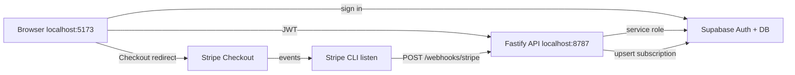

# ResizePack — Operations & maintenance runbook

> **Purpose:** How this project is hosted, which services we use, how to run everything locally, how to deploy, and how to maintain it over time.  
> **Keep updated:** When you add a service, change env vars, or fix a recurring issue, update this file (and note it in `bulk-image-tool-brief.md` §20 decision log if it affects product/architecture).  
> **Last updated:** 2026-06-03

**Related docs**

| Document | Use for |
|----------|---------|
| `bulk-image-tool-brief.md` | Product scope, locked decisions, monetization rules |
| `README.md` | Quick start, scripts |
| `DEPLOY.md` | Vercel static deploy (v1 + frontend) |
| `LAUNCH.md` | Search Console, first launch checklist |
| `LAUNCH-POSTS.md` | Copy for community posts |
| `.env.example` | All environment variable names |

---

## 1. What ResizePack is (two layers)

| Layer | What runs | Where |
|-------|-----------|--------|
| **v1 tool** | Image resize/compress + ZIP in the **browser** | Static files on **Vercel** |
| **Phase 2** | Accounts (Supabase), billing (Stripe), entitlements API | **Supabase** + **Stripe** + **`apps/api`** (Fastify) |

Production today:

- **Live site:** https://www.resizepack.tech/
- **Repo:** GitHub → connected to Vercel (auto-deploy on push to main)
- **Phase 2 API (test mode):** `https://resizepack-api.onrender.com` — Stripe **test** webhook + Vercel `VITE_*` env wired. **Live** Stripe charges require §6.3 cutover + accountant/legal gates.

---

## 2. Services & accounts (what each does)

### 2.1 GitHub

- **Role:** Source code, version history, triggers Vercel deploys.
- **URL:** Your repo under `Full Stack Apps/ResizePack` (or org copy).
- **You use it for:** Push code, PRs, rollback via revert commits.
- **Secrets:** Never commit `.env.local`. It is gitignored via `*.local`.

### 2.2 Vercel

- **Role:** Hosts the **frontend** (Vite build → static `dist/`).
- **URL:** https://www.resizepack.tech/
- **Dashboard:** https://vercel.com/dashboard
- **Settings that matter:**
  - Framework: **Vite**
  - Build: `pnpm build`
  - Output: `dist`
  - **Environment variables** (Production + Preview when ready):
    - `VITE_SUPABASE_URL`
    - `VITE_SUPABASE_ANON_KEY`
    - `VITE_API_BASE_URL` → must point to your **hosted API** when Phase 2 is live in prod (not `localhost`)
    - `VITE_GA_MEASUREMENT_ID` (optional, GA4)
- **Deployment protection:** If enabled, Google Search Console and anonymous users may fail to fetch the site — disable for public marketing URL or use bypass for bots (you fixed this once for sitemap).
- **Cost:** Hobby tier — fine for static SPA at current scale.

### 2.3 Google Search Console

- **Role:** Tell Google about the site, submit sitemap, see indexing/coverage.
- **URL:** https://search.google.com/search-console
- **Property:** `https://www.resizepack.tech/` (URL prefix)
- **Sitemap:** `https://www.resizepack.tech/sitemap.xml`
- **Verification:** HTML tag or DNS (however you verified on Vercel).
- **Maintenance:** After deploy or URL changes, resubmit sitemap if needed; check Coverage for errors every few weeks.

### 2.4 Google Analytics 4 (optional)

- **Role:** Page views / traffic (privacy-conscious, no image data).
- **Activated only when** `VITE_GA_MEASUREMENT_ID` is set in Vercel (or `.env.local` locally).
- **Dashboard:** https://analytics.google.com/
- **Maintenance:** Confirm Realtime after deploy when you change the measurement ID.

### 2.5 Supabase

- **Role:** Auth (email/password), Postgres (`profiles`, `subscriptions`, `usage_events`), Row Level Security.
- **Project ref (current):** `ypxjadrmxxfikuygkgeg`
- **URL:** `https://ypxjadrmxxfikuygkgeg.supabase.co`
- **Dashboard:** https://supabase.com/dashboard → your project
- **You use it for:**
  - **Authentication → Users:** see signups
  - **Table Editor:** `profiles`, `subscriptions` (plan should show `active` after paid webhook)
  - **SQL Editor:** run `supabase/schema.sql` once, then fixes like `supabase/fix-subscriptions-unique.sql` if needed
  - **Project Settings → API:** copy `anon` key (frontend) and `service_role` key (**API only**, never in frontend)
- **Schema file:** `supabase/schema.sql`
- **RLS:** Users read own rows; API uses **service role** to write subscriptions from webhooks.
- **Cost:** Free tier for development.

### 2.6 Stripe

- **Role:** Test/live payments, Checkout, Customer Portal, webhooks.
- **Dashboard:** https://dashboard.stripe.com/ (toggle **Test mode** for development)
- **Product (test):** ResizePack Pro — recurring (e.g. €9/mo)
- **Price ID:** in `.env.local` as `STRIPE_PRICE_ID`
- **Keys:**
  - `STRIPE_SECRET_KEY` — `sk_test_...` (server / API only)
  - `STRIPE_WEBHOOK_SECRET` — `whsec_...` (server / API only)
- **Customer Portal:** Enable in Stripe Dashboard → Settings → Billing → Customer portal (required for “Manage billing”).
- **Local webhooks:** Stripe cannot reach `localhost` directly — use **Stripe CLI** (§4.3).
- **Production webhooks (later):** Dashboard → Developers → Webhooks → endpoint URL `https://your-api.com/webhooks/stripe` with signing secret in hosted API env.

### 2.7 Node.js + pnpm (local only)

- **Node:** 20+ recommended (you use 24.x).
- **pnpm:** install deps, run `dev` / `build`.
- **Monorepo:** root = frontend; `apps/api` = API package (`pnpm-workspace.yaml`).

### 2.8 Stripe CLI (local dev only)

- **Role:** Forwards Stripe events to `http://localhost:8787/webhooks/stripe`.
- **Install:** https://stripe.com/docs/stripe-cli
- **Login once:** `stripe login`
- **Note:** `stripe` may work in **Windows PowerShell** but not in Cursor’s integrated terminal if PATH differs — use normal PowerShell when in doubt.

### 2.9 API hosting — Render free tier (chosen 2026-06-02)

The Fastify app in `apps/api` runs on a public HTTPS URL for production billing. **Chosen host: Render free web service** (completely free, no card; upgrade to always-on later when it earns). Vercel cannot run this as a long-lived server. Blueprint committed as **`render.yaml`** at repo root.

- **Free-tier tradeoff:** service **spins down after ~15 min idle**, cold-starts (~50s) on next request. Stripe **retries webhooks for days**, so subscriptions still sync; the only annoyance is a slow first request after idle. The `/account?checkout=success` page polls ~16s — if the API was cold, plan may still read Free; a manual refresh once warm shows Pro.
- **"Stay warm" (implemented, free):** `.github/workflows/keepalive.yml` is a GitHub Actions cron that pings `/health` every 10 min — keeps the service awake within Render's 750 free hours/month (one always-on service ≈ 730 hrs), with no third-party signup. URL defaults to `https://resizepack-api.onrender.com`; override via repo variable `API_URL` (Settings → Secrets and variables → Actions → Variables) if your Render URL differs. **Caveat:** GitHub cron is best-effort and can lag under load, so occasional cold starts may still slip through. For rock-solid warmth, add a free **UptimeRobot** 5-min HTTP monitor on the same `/health` URL as a more reliable belt-and-suspenders. **Note:** GitHub disables scheduled workflows after 60 days of zero repo activity — a push re-enables them.
- **Upgrade path when earning:** Render Starter (~$7/mo, always-on) is a one-setting flip, or move to Railway.

**Deploy steps (first time):**

1. Render Dashboard → **New → Blueprint** → connect the GitHub repo → it reads `render.yaml`.
2. Fill the 5 secret env vars (marked `sync: false`): `STRIPE_SECRET_KEY`, `STRIPE_WEBHOOK_SECRET`, `STRIPE_PRICE_ID`, `SUPABASE_URL`, `SUPABASE_SERVICE_ROLE_KEY`. (`NODE_ENV`, `WEB_ORIGIN`, `RATE_LIMIT_MAX` are preset in the blueprint.)
3. Deploy → wait for **Live** → confirm `https://<service>.onrender.com/health` → `{"ok":true}`.
4. **Stripe** (Dashboard → Developers → Webhooks): add endpoint `https://<service>.onrender.com/webhooks/stripe`, select events `checkout.session.completed`, `customer.subscription.updated`, `customer.subscription.deleted`; copy its **signing secret** into Render's `STRIPE_WEBHOOK_SECRET` (this replaces the local `stripe listen` secret in prod — no CLI in production).
5. **Vercel:** set `VITE_API_BASE_URL=https://<service>.onrender.com` (+ `VITE_SUPABASE_URL`, `VITE_SUPABASE_ANON_KEY`) → redeploy frontend.
6. Smoke test on the live site: sign up → Upgrade → test card → Account shows Pro; Supabase `subscriptions` row `active`.

**Troubleshooting — "Manage billing" returns 400 / "Unable to open billing portal":**
The portal endpoint logs the exact Stripe cause (`Portal session creation failed` with `stripeType`/`stripeCode`/`stripeMessage`). Read the Render log line and match:
- **"No configuration provided … default configuration has not been created"** → the Customer Portal isn't configured **in the same Stripe mode as the API keys**. Stripe Dashboard → in the matching mode (TEST vs LIVE — check whether Render's `STRIPE_SECRET_KEY` is `sk_test_` or `sk_live_`) → Settings → Billing → **Customer portal** → activate & save. (Configuring LIVE while Render runs TEST keys, or vice-versa, is the usual cause.)
- **"No such customer: cus_…"** → the stored `stripe_customer_id` was created in the *other* mode. Align the keys, or clear that user's `subscriptions` row so the next checkout creates a fresh customer in the current mode.

**Account deletion (`POST /account/delete`):** cancels the Stripe subscription immediately (no refund), deletes the Stripe customer (Stripe still retains invoices for tax/legal — GDPR Art 17(3)(b)), then deletes the Supabase auth user, which **FK-cascades** to `profiles`+`subscriptions` and nulls `usage_events`. A webhook arriving after deletion FK-fails harmlessly (logged). No migration needed.

---

## 3. Environment variables

Copy `.env.example` → `.env.local` at repo root (never commit).

| Variable | Where used | Notes |
|----------|------------|--------|
| `VITE_SUPABASE_URL` | Frontend | Public |
| `VITE_SUPABASE_ANON_KEY` | Frontend | Public (RLS protects data) |
| `VITE_API_BASE_URL` | Frontend | Local: `http://localhost:8787` |
| `VITE_GA_MEASUREMENT_ID` | Frontend | Optional |
| `SUPABASE_URL` | API | Same URL as above |
| `SUPABASE_SERVICE_ROLE_KEY` | API | **Secret** — bypasses RLS |
| `STRIPE_SECRET_KEY` | API | `sk_test_...` or live later |
| `STRIPE_WEBHOOK_SECRET` | API | From `stripe listen` locally; from Dashboard in prod |
| `STRIPE_PRICE_ID` | API | Test price id |
| `WEB_ORIGIN` | API | `http://localhost:5173` local; prod = comma-separated allowlist `https://www.resizepack.tech,https://resizepack.tech,https://resizepack.vercel.app` (first entry is canonical → used for Stripe redirect URLs) |

**API loads env:** `apps/api` uses `dotenv` to read `../../.env.local`.

**After changing `.env.local`:** Restart **API** (`pnpm --dir apps/api dev`). Vite reloads frontend env on save.

**Stripe CLI secret changes every time** you start a new `stripe listen` session (usually). Copy new `whsec_...` → `.env.local` → restart API.

---

## 4. Local development — startup order

You need **three** processes for full Phase 2 (auth + upgrade flow).

### 4.1 One-time setup

```powershell
cd "C:\Users\Walking Dead\Desktop\Programming\Full Stack Apps\ResizePack"
pnpm install
```

1. Create `.env.local` from `.env.example` and fill all values.
2. In Supabase SQL Editor, run full `supabase/schema.sql` (once per project).
3. If you already ran an older schema, also run `supabase/fix-subscriptions-unique.sql` (once).
4. `stripe login` in PowerShell (once).

### 4.2 Every dev session (order matters)

| Step | Terminal | Command | Success signal |
|------|----------|---------|----------------|
| **1** | Cursor or PowerShell #1 | `pnpm dev` | `Local: http://localhost:5173/` |
| **2** | Cursor or PowerShell #2 | `pnpm --dir apps/api dev` | `Server listening at http://127.0.0.1:8787` |
| **3** | **Windows PowerShell** #3 (recommended) | `stripe listen --forward-to localhost:8787/webhooks/stripe` | `Ready! ... webhook signing secret is whsec_...` |

**Before step 2 after step 3:** Paste `whsec_...` into `.env.local` as `STRIPE_WEBHOOK_SECRET`, then start or **restart** the API.

**Quick health checks:**

```powershell
curl http://localhost:8787/health
# → {"ok":true}
```

### 4.3 Reading the Stripe CLI window

Example (good):

```text
checkout.session.completed [evt_...]
<--  [200] POST http://localhost:8787/webhooks/stripe [evt_...]
```

- **`[200]`** — API accepted webhook; check API logs for `Subscription sync failed` (should not appear after DB/API fix).
- **`[400]`** — Often wrong `STRIPE_WEBHOOK_SECRET` (CLI secret ≠ `.env.local`).

Other events (`invoice.paid`, `customer.subscription.created`, etc.) also return 200; only some update our DB. The important one for first upgrade is **`checkout.session.completed`**.

### 4.4 Test the billing flow

1. Open http://localhost:5173/
2. Sign up / log in → **Account**
3. **Upgrade with Stripe** → use test card `4242 4242 4242 4242`, any future expiry, any CVC
4. Return to `/account?checkout=success`
5. Plan should show the **Pro** badge with "renews on <date>" within a few seconds
6. Supabase → `subscriptions` → row with `status = active`

**Subscription status states to verify** (shared model in `src/utils/subscriptionStatus.ts`, shown on both Account and the tool banner):

| State | How to reach it | Account / tool copy |
|-------|------------------|---------------------|
| `pro_active` | Active subscription | Badge **Pro** — "renews on <date>" |
| `pro_until` | Cancel via Customer Portal (status stays `active`, `cancel_at_period_end = true`) | Badge **Pro until** — "you keep every feature until then" + **Resume subscription** |
| `free_ended` | After the period ends (`customer.subscription.deleted`, status `canceled`) | Badge **Free** — "your Pro plan ended on <date>" + **Renew Pro** |
| `free` | Never subscribed | Badge **Free** — taster limits |

Note: cancel/resume go through `POST /billing/create-portal-session` (the Stripe Customer Portal). There is no reliable public deep-link straight to the portal cancel screen, so the buttons open the portal session rather than a direct Stripe URL.

### 4.5 If plan stays `free (free)` after successful Stripe CLI `[200]`

Check API terminal for:

```text
"msg":"Subscription sync failed"
```

| Error / symptom | Fix |
|-----------------|-----|
| `no unique or exclusion constraint matching the ON CONFLICT` | Run `supabase/fix-subscriptions-unique.sql` in Supabase; restart API (code now uses update/insert without requiring this, but constraint is still recommended) |
| `401` on `/entitlements` | `SUPABASE_SERVICE_ROLE_KEY` must match **same project** as `VITE_SUPABASE_URL` (ref in JWT must match) |
| Webhooks never appear | Start `stripe listen` **before** paying; restart API after updating `whsec_` |
| `EADDRINUSE` on 8787 | Another API still running — see §5.2 |
| Paid in Stripe, empty `subscriptions` table | Resend event: Stripe Dashboard → Developers → Events → `checkout.session.completed` → Resend (with CLI listening), or upgrade again in test mode |

---

## 5. Troubleshooting

### 5.1 Port 8787 already in use (`EADDRINUSE`)

```powershell
netstat -ano | findstr :8787
taskkill /PID <pid-from-listening-row> /F
pnpm --dir apps/api dev
```

Only one API instance at a time.

### 5.2 Stripe CLI not found in Cursor terminal

Use **Start → PowerShell** where `stripe --version` works, or add Stripe CLI to system PATH.

### 5.3 Checkout returns 400 from API

Historically: frontend sent `Content-Type: application/json` with empty body. Fixed in `src/utils/api.ts`. If it returns, check API log for the error body.

### 5.4 “Manage billing” fails

Enable **Customer Portal** in Stripe test dashboard. User must have completed checkout once (Stripe customer id in `subscriptions`).

### 5.5 Google Search Console “Couldn’t fetch” sitemap

Often temporary, or Vercel deployment protection blocking Googlebot. Wait 24–48h; confirm sitemap URL in browser; check property URL matches live site exactly.

### 5.6 Render API build cannot find API-only packages

Symptom:

```text
Cannot find module 'dotenv'
Cannot find module '@fastify/rate-limit'
Cannot find module 'fastify-raw-body'
```

Cause: Render installed the root package only because `apps/api` was not listed as a pnpm workspace package.

Fix: `pnpm-workspace.yaml` must include:

```yaml
packages:
  - apps/*
```

Then run `pnpm install --lockfile-only`, commit `pnpm-workspace.yaml` + `pnpm-lock.yaml`, push, and redeploy on Render.

### 5.7 Render API starts then fails with `ERR_MODULE_NOT_FOUND ... dist/env`

Symptom:

```text
Error [ERR_MODULE_NOT_FOUND]: Cannot find module '/opt/render/project/src/apps/api/dist/env'
imported from /opt/render/project/src/apps/api/dist/index.js
```

Cause: the API is native ESM (`"type": "module"`), and Node requires local runtime imports to include the compiled `.js` extension. TypeScript accepted `import './env'`, but plain Node on Render could not resolve it after build.

Fix: source imports local API files with `.js`, for example:

```ts
import { loadEnv } from './env.js';
```

Build check: `pnpm --dir apps/api build`, then confirm `apps/api/dist/index.js` imports `./env.js`.

---

## 6. Production deploy checklist

### 6.1 Frontend (Vercel) — current

1. `pnpm lint && pnpm build` locally.
2. Push to GitHub → Vercel builds automatically.
3. Set Vercel env vars for Phase 2 when ready (§3).
4. Smoke test: upload → ZIP, `/privacy` (+ `/terms`, `/refund`), login, account page.

### 6.2 API (when you go live with billing)

**Host: Render free tier** — full step-by-step in **§2.9**. Summary:

1. Deploy `apps/api` via the committed `render.yaml` blueprint (HTTPS automatic).
2. Set the 5 secret env vars in Render (`sync: false` keeps them out of git); `NODE_ENV=production` makes `WEB_ORIGIN` required (CORS lock-down).
3. Add the production **Stripe webhook** endpoint → put its signing secret in Render `STRIPE_WEBHOOK_SECRET` (no Stripe CLI in prod).
4. `WEB_ORIGIN=https://www.resizepack.tech,https://resizepack.tech,https://resizepack.vercel.app` (comma-separated allowlist; first entry is canonical and builds Stripe redirect URLs; preset in blueprint).
5. `VITE_API_BASE_URL=https://<service>.onrender.com` on Vercel → redeploy frontend.
6. Stripe **live** mode (new keys, price, webhook) + accountant/tax + Terms/Privacy/refund **before real charges** (`bulk-image-tool-brief.md` §24). Test mode is fine until then.

### 6.3 Stripe live cutover runbook (test → live)

The API has **no hardcoded mode** — going live is an env/config swap, not a code change. Do these in order:

**Non-code gates (must be done first):**
1. Stripe business/identity verification complete (Dashboard shows live mode available).
2. Accountant / Greece tax setup: invoicing, VAT/OSS, income declaration (brief §24).
3. Legal pages reviewed: set `SUPPORT_EMAIL` in [`src/config/site.ts`](src/config/site.ts) to a real monitored address and remove the "Draft for review" banners in the legal page components once a professional has signed off.

**Stripe (live mode):**
4. Toggle the Dashboard to **live mode**.
5. Create the live **Product + Price** (recurring €9/mo) → copy the live `price_...`.
6. Developers → Webhooks → add endpoint `https://resizepack-api.onrender.com/webhooks/stripe` with events `checkout.session.completed`, `customer.subscription.updated`, `customer.subscription.deleted` → copy the live signing secret (`whsec_...`).
7. Settings → Billing → **Customer portal**: enable cancellation "at end of billing period" (mirror test config, §10.2).

**Render (live env):**
8. Update env vars: `STRIPE_SECRET_KEY` (live `sk_live_...`), `STRIPE_PRICE_ID` (live price), `STRIPE_WEBHOOK_SECRET` (live `whsec_`). Keep the test values noted somewhere for rollback.
9. Redeploy; confirm `/health` is `{"ok":true}`.

**Verify:**
10. Real card, small charge → Account shows Pro → cancel via portal → `Pro until` → optionally refund from Stripe. Roll back by restoring test env values if anything is wrong.

---

## 7. Maintenance (ongoing)

Update this section when your routine changes.

### 7.1 Weekly (while actively developing)

- [ ] Pull latest `main`, `pnpm install` if lockfile changed
- [ ] Glance at Vercel deploy status after pushes
- [ ] If testing billing: confirm 3 terminals + matching `whsec_`

### 7.2 Monthly (after launch)

- [ ] Search Console: coverage, sitemap status
- [ ] Supabase: auth usage vs free tier limits
- [ ] Vercel: bandwidth / build minutes
- [ ] Stripe test dashboard: clean up old test customers if cluttered
- [ ] Dependency updates: `pnpm update` + run `pnpm build` + quick ZIP test

### 7.3 When changing secrets

| Change | Action |
|--------|--------|
| New Stripe webhook secret | Update API env, restart API / redeploy API |
| Rotated Supabase service role | Update `.env.local` + API host, restart API |
| New Supabase anon key | Update Vercel + `.env.local`, redeploy frontend |
| New Stripe price | Update `STRIPE_PRICE_ID`, redeploy API |

### 7.4 When adding features

1. Update `bulk-image-tool-brief.md` if scope/decisions change (§19, §20).
2. Update `OPERATIONS.md` if new service, env var, or terminal/process.
3. Update `.env.example` for any new variable.
4. If DB changes: add SQL under `supabase/` and run in Supabase SQL Editor; document in §7.5.

### 7.5 Database migrations

- **Initial:** `supabase/schema.sql`
- **Fixes / additive migrations (run manually in SQL Editor, note date in brief §20):**
  - `supabase/fix-subscriptions-unique.sql` — unique constraint on `stripe_subscription_id`
  - `supabase/add-cancel-at-period-end.sql` — adds `cancel_at_period_end` column. **Run this before deploying the API build that writes it**, or webhook subscription sync will fail with "column does not exist".
- Prefer idempotent SQL (`if not exists`) for fixes

### 7.6 Before taking real money

- [ ] Accountant meeting (Greece / EU context — brief §24)
- [ ] Stripe live mode + live webhook
- [ ] Terms, Privacy (Stripe mentioned), refund policy
- [ ] API hosted with HTTPS
- [ ] Remove or secure test accounts

### 7.7 Backups & recovery

- **Code:** GitHub is source of truth
- **DB:** Supabase project backups on paid plans; export critical tables manually before big migrations
- **Stripe:** Subscription state of record; app DB should match via webhooks

---

## 8. Architecture diagram (Phase 2 local)



---

## 9. File map (ops-relevant)

| Path | Purpose |
|------|---------|
| `src/` | React app, auth, account page, tool + plan gating |
| `src/config/plans.ts` | Free/Pro limits (single source of truth) |
| `src/config/site.ts` | Support email + site URL constants |
| `src/pages/legal/*` | In-app Privacy / Terms / Refund routes + shared layout |
| `apps/api/src/index.ts` | Entitlements, checkout, portal, webhooks |
| `supabase/schema.sql` | Tables + RLS |
| `supabase/*.sql` | Additive migrations (run manually — §7.5) |
| `vercel.json` | SPA rewrite + cache headers |
| `render.yaml` | Render API deploy blueprint |
| `.github/workflows/ci.yml` | CI: lint + build on push/PR |
| `.env.local` | Local secrets (gitignored) |
| `public/sitemap.xml` | SEO |
| `index.html` | Meta / title / font preload |

---

## 10. Auth providers (OAuth) & Customer Portal setup

### 10.1 OAuth — "Continue with Google / GitHub"

The login page calls `supabase.auth.signInWithOAuth({ provider, options: { redirectTo: <origin>/account } })`. Buttons exist in code but **each provider must be enabled in Supabase + backed by an OAuth app**, or the button errors.

The login page calls `signInWithProvider` for **Google and GitHub** ([`src/pages/LoginPage.tsx`](src/pages/LoginPage.tsx)). Each provider must be enabled in Supabase + backed by an OAuth app, or the button errors. **Facebook was removed** from the UI (Meta setup/review not worth it for v1).

**Supabase (one-time):** Dashboard → Authentication → **URL Configuration**:
- **Site URL:** `https://www.resizepack.tech`
- **Redirect URLs (allowlist):** add `https://www.resizepack.tech/**` (wildcard covers `/login?confirmed=1` and `/account`), keep `https://resizepack.vercel.app/**` as fallback, and `http://localhost:5173/**` for local dev.

**Google:** Authentication → Providers → Google → enable. Create OAuth credentials in **Google Cloud Console** (APIs & Services → Credentials → OAuth client ID → Web application). Authorized redirect URI = the **Supabase callback** shown on the provider page (`https://<ref>.supabase.co/auth/v1/callback`). Paste Client ID + Secret into Supabase.

**GitHub:** Authentication → Providers → GitHub → enable. Create a **GitHub OAuth App** (Settings → Developer settings → OAuth Apps). Authorization callback URL = the same Supabase callback URL. Paste Client ID + Secret into Supabase.

**Facebook:** not offered in the app. Leave disabled in Supabase (Authentication → Providers → Facebook).

### 10.3 Email confirmation (and cross-device verify)

Sign-up sends a confirmation link. `signUp` sets `emailRedirectTo` to `<origin>/account`, and the login page shows a "Confirm your email" screen after sign-up.

For the link to work (including when opened on a different device than sign-up):
- Supabase Site URL + redirect allowlist must include the deployed app (above).
- The app uses **implicit** auth flow in [`src/supabase/client.ts`](src/supabase/client.ts) (`flowType: 'implicit'`, `detectSessionInUrl: true`). Clicking the link confirms the account; the user then signs in on whichever device they want. (PKCE would tie confirmation to the originating browser — avoid for email confirm if cross-device is desired.)
- Review the confirmation email template under Authentication → Email Templates if you want to customize copy.

**Production email (Resend):** Supabase's built-in email is rate-limited (~a few/hour) and unbranded, so before driving real signups configure custom SMTP via **Resend** (`noreply@resizepack.tech`) and paste the branded templates. Full runbook + ready-to-paste HTML: [`EMAIL-SETUP.md`](EMAIL-SETUP.md). Password reset (`/reset-password`, [`src/pages/ResetPasswordPage.tsx`](src/pages/ResetPasswordPage.tsx)) uses the same recovery email + the wildcard redirect allowlist.

### 10.2 Customer Portal — allow cancellation

Stripe Dashboard (test mode) → Settings → Billing → **Customer portal**:
- Enable **Cancel subscriptions** → set to **at end of billing period** (so the user keeps Pro for the remaining days).
- Optionally allow plan switches / payment method updates.

App behavior: on cancel, Stripe sends `customer.subscription.updated` with `cancel_at_period_end = true` (status stays `active`). Our webhook stores it; `/entitlements` returns `cancelAtPeriodEnd`; the Account page shows "Cancels on <date> — you keep Pro until then" and offers resume via the portal. Plan flips to Free only when the period actually ends (`customer.subscription.deleted`).

---

## 11. CI (GitHub Actions)

[`.github/workflows/ci.yml`](.github/workflows/ci.yml) runs on every push and PR to `main`:

1. `pnpm install --frozen-lockfile`
2. `pnpm lint`
3. `pnpm build` (frontend typecheck + Vite build)
4. `pnpm --dir apps/api build` (API typecheck)

This catches breakage before Vercel/Render auto-deploy (which still happen on push). It does **not** deploy — hosting is handled by Vercel and Render.

Optional later: enable branch protection on `main` requiring the CI check to pass before merge (GitHub → Settings → Branches → add rule).

---

## 12. Legal pages & fonts notes

- **Legal pages are in-app React routes:** `/privacy`, `/terms`, `/refund` (`src/pages/legal/*`), sharing `LegalLayout`. The old `public/*.html` files are now thin redirects to those routes (kept for any external links). Footer/hero links use in-app `<Link>` (same tab). Support email lives in [`src/config/site.ts`](src/config/site.ts).
- **Font FOUC / style-on-refresh fix:** `index.html` preloads the Google Fonts stylesheet; `vercel.json` sets `immutable` cache for `/assets/*` and `must-revalidate` for HTML; `main.tsx` reloads on bfcache restore (`pageshow` + `persisted`) so a back/refresh never shows stale pre-deploy styling.

---

*When this runbook disagrees with `bulk-image-tool-brief.md` on **product** decisions, the brief wins. On **how to run and maintain** the repo, this file wins.*
