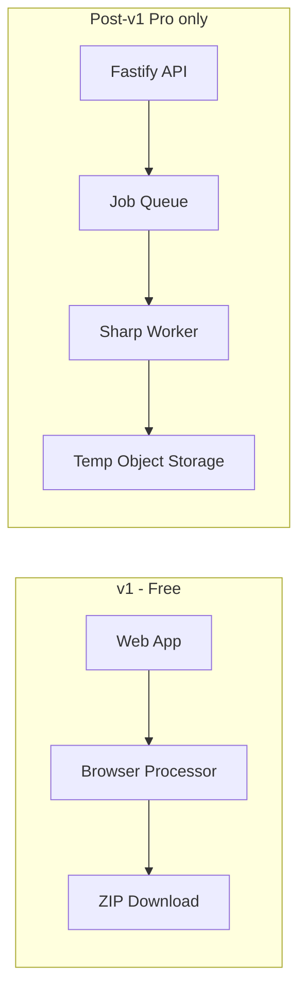

# ResizePack — Project Master Brief

> **Status:** **In progress** — v1 live on Vercel; **Phase 2 billing works in test-mode production** (Render API + Stripe test webhook + Vercel env); **post-launch polish batch shipped** (fonts/FOUC, in-app legal, auth UX, OAuth Facebook, CI, live Stripe runbook)  
> **Code location:** `Full Stack Apps/ResizePack/` — frontend SPA at repo root + `apps/api/` (Fastify)  
> **Product name:** **ResizePack** (locked 2026-05-20)  
> **Display / npm name:** `ResizePack` / `resizepack` (package.json)  
> **Domain (verify before purchase):** `resizepack.com`, `resizepack.io` — not required; live on `resizepack.vercel.app`  
> **Author:** Panos, 21, self-taught developer (runs git himself)  
> **Last updated:** 2026-06-03 (post-launch polish: FOUC/fonts, legal routes, auth UX, cross-device email, OAuth Facebook, CI, Stripe live runbook — OPERATIONS §6.3/§10–§12)  
> **Purpose of this document:** Single source of truth for any AI agent or human collaborator. **Keep this file fully updated after every change** — status, how things were built, apps, web, maintenance, testing, production, and security. Satellite docs (`README.md`, `DEPLOY.md`, `OPERATIONS.md`, `LAUNCH.md`) hold step detail; this brief indexes and summarizes them (§26).

**Related project (separate brief):** [PanChat — thread-task-chat-brief.md](./thread-task-chat-brief.md) — portfolio full-stack app; this tool is a **parallel** self-serve utility track.

---

## How to use this document (for AI agents)

1. Read **§1–§7** first for goals, constraints, and author-provided answers.
2. Treat **§8** as the locked **v1 scope** unless the author explicitly changes it.
3. **v1 is 100% free** — no paywalls, no Stripe, no “Upgrade” CTAs (§7, §9).
4. **v1 ship order:** browser resize + ZIP **first** — **no** Postgres/Fastify/API in v1 unless author explicitly asks (§10, §23).
5. **Positioning:** **Bulk Image Optimizer** hero — Etsy is a **preset + SEO**, not the product category (§3, §23).
6. Billing, Stripe, Greece tax context: **§24** (informational only — not legal advice).
7. Analytics & deploy: **§23** when author is ready; day-to-day ops: **§26** + `OPERATIONS.md`.
8. **Do not invent timelines** — author works at own pace (§7 Q4).
9. Track decisions in **§19**; do not add features from **§9** to v1 without author approval.
10. UI copy: **English only** in v1 (§7 Q2).

---

## Table of contents

1. [Executive summary](#1-executive-summary)
2. [Author context and motivation](#2-author-context-and-motivation)
3. [Problem and product positioning](#3-problem-and-product-positioning)
4. [Prior context — why this project](#4-prior-context--why-this-project)
5. [Project goals and non-goals](#5-project-goals-and-non-goals)
6. [Discovery answers (author-provided)](#6-discovery-answers-author-provided)
7. [Functional requirements — v1 (all free)](#7-functional-requirements--v1-all-free)
8. [Image presets and processing rules](#8-image-presets-and-processing-rules)
9. [Functional requirements — post-v1 (monetization-ready)](#9-functional-requirements--post-v1-monetization-ready)
10. [SaaS architecture principles](#10-saas-architecture-principles)
11. [Recommended tech stack](#11-recommended-tech-stack)
12. [System architecture](#12-system-architecture)
13. [Privacy, security, and abuse prevention](#13-privacy-security-and-abuse-prevention)
14. [UI and UX direction](#14-ui-and-ux-direction)
15. [Suggested build phases (no dates)](#15-suggested-build-phases-no-dates)
16. [Risks and mitigations](#16-risks-and-mitigations)
17. [Launch and validation (when ready)](#17-launch-and-validation-when-ready)
18. [Future monetization model (design only — not v1)](#18-future-monetization-model-design-only--not-v1)
19. [Open questions log](#19-open-questions-log)
20. [Conversation and decision history](#20-conversation-and-decision-history)
21. [Next actions](#21-next-actions)
22. [External review & locked decisions (2026-05)](#22-external-review--locked-decisions-2026-05)
23. [Analytics & deploy (practical v1)](#23-analytics--deploy-practical-v1)
24. [Revenue, Stripe & Greece — author context (not legal advice)](#24-revenue-stripe--greece--author-context-not-legal-advice)
25. [Appendices](#25-appendices)
26. [Operations & maintenance runbook](#26-operations--maintenance-runbook)

---

## 1. Executive summary

**ResizePack** is a **self-serve bulk image resize/compress tool** (positioned as a **Bulk Image Optimizer**, not an “Etsy app”). Users drop many files, pick a preset (including **Etsy listing**), download **one ZIP** — no accounts in v1, no custom work per customer.

| Dimension | Choice |
|-----------|--------|
| **Product name** | **ResizePack** |
| **Domain** | Target `resizepack.com` or `resizepack.io` — check registrar; v1 OK on `*.vercel.app` |
| **Competitive note** | Author search for “ResizePack” surfaced **SammaPix** (sammapix.com) — different brand; proceed with ResizePack |
| **Category (hero)** | **Bulk resize & compress images** |
| **Niche (preset + SEO)** | Etsy, Shopify, blogs, websites — **Etsy is one preset**, not the whole brand |
| **Primary purpose** | **Learning** + shipped utility; optional **future income** |
| **v1 pricing** | **Completely free** — full feature set for normal use; no ads |
| **Target audience** | Anyone batch-optimizing images; **especially** marketplace sellers and bloggers |
| **v1 scope** | Multi-file upload, presets (Etsy / Web / Custom), JPEG/WebP output, EXIF strip, ZIP download |
| **v1 architecture** | **Browser-only SPA** — process in client; **no** API/Postgres in v1 (§10) |
| **Language** | **English only** (UI + marketing) |
| **Timeline** | **None** — author implements whenever |
| **Future architecture** | Monorepo + API + DB **when** Pro/server processing is built — not before first ZIP works |
| **Monetization in v1** | **None** — no Stripe, no Gumroad, no Pro tier UI |
| **Relation to PanChat** | Parallel project; does not replace PanChat deploy/portfolio work |

**v1 philosophy:** One sharp job — **“many images → optimized → one ZIP”** — with **platform presets** (Etsy first in SEO copy), not another generic single-file compressor.

---

## 2. Author context and motivation

| Item | Detail |
|------|--------|
| Background | IEK multimedia graduate; strong React/TS, Node/Fastify, Prisma, Docker from **PanChat** and other portfolio work |
| Income context | Very limited budget (~no spend on tools/ads); first commercial-style product experiment |
| Work style | **No schedule pressure** — build when motivated |
| Success definition (v1) | **Working deployed tool + learning** — revenue is optional later |
| What author rejected (other brainstorm) | Local business web services, custom design per client, ad-heavy converter sites, platform downloaders |

---

## 3. Problem and product positioning

### 3.1 User pain

| Pain | Detail |
|------|--------|
| Volume | Sellers upload **dozens** of listing images per product/session |
| Rules | Platforms expect **specific dimensions and file sizes**; wrong files waste time or get rejected |
| Tools today | Generic resizers exist but are **cluttered**, ad-heavy, or one-file-at-a-time |
| Privacy | Users may not want photos **stored** on unknown servers |

### 3.2 What we sell (positioning) — **LOCKED 2026-05**

**Not:** “Etsy tool” or “another image compressor” competing head-on with TinyPNG / iLoveIMG on generic keywords.

**Not (SEO trap):** Primary target keyword `image compressor` — too competitive.

**Yes (hero — broad):**

> **Bulk Resize & Compress Images**  
> Perfect for Etsy, Shopify, blogs, and websites.

**Yes (use case line):**

> Drop dozens of photos → pick a preset → download one ZIP.

**Yes (SEO — narrow pages/long-tail):** Optimize landing sections and meta for phrases like:

- `bulk resize images for etsy`
- `bulk image optimizer for etsy`
- `etsy listing photo resizer`
- `bulk compress images for website`

**Code does not change:** Etsy remains a **preset**; marketing widens the funnel.

### 3.3 Competitive differentiation (v1 messaging)

1. **Bulk + ZIP + EXIF strip** in one clean flow (not one-file-at-a-time).
2. **Preset row:** Etsy | Web | Custom — Etsy prominent but not the product title.
3. **Clean UI, no ads.**
4. **Privacy story:** **in-browser processing** in v1 — files stay on the user’s device (§12).
5. **Legal:** “Not affiliated with Etsy, Inc.” (and same pattern if naming Shopify in copy).
6. **SEO:** broad hero + **long-tail** Etsy (and later Shopify) — see §25.2.

---

## 4. Prior context — why this project

| Source | Insight |
|--------|---------|
| Income brainstorm | Chose **batch/convert** track over directories/finders and over local business services |
| Shortlist | Interested in batch QR and sitemap tools; **picked bulk images first** for learning + clearer value |
| PanChat | Proves full-stack; this project proves **file pipelines, SEO landing, self-serve product** |
| Budget | Must run on **free tiers** until/unless revenue exists |

---

## 5. Project goals and non-goals

### 5.1 Goals

| # | Goal |
|---|------|
| G1 | Ship a **usable v1** that author is proud to link in portfolio |
| G2 | Learn **binary/file handling**, compression, ZIP, deploy of a utility app |
| G3 | Write **clean, modular code** so future Pro/API is additive — **without** building unused infra in v1 |
| G4 | Keep **zero mandatory cost** for author during v1 |
| G5 | English landing page readable by **global** Etsy/web audience |

### 5.2 Non-goals (v1)

| # | Non-goal |
|---|----------|
| NG1 | Revenue, subscriptions, or payment integration |
| NG2 | Ads or ad networks |
| NG3 | Custom work per user (design, manual optimization) |
| NG4 | Claiming official partnership with Etsy, Shopify, etc. |
| NG5 | AI upscale, background removal, DAM, cloud galleries |
| NG6 | Mobile native apps |
| NG7 | Greek UI in v1 |
| NG8 | Fixed deadlines or milestone dates in project management |

---

## 6. Discovery answers (author-provided)

| # | Topic | Answer |
|---|-------|--------|
| Q1 | **Pricing at launch** | **Completely free** — even if revenue later, v1 has **no paywall** |
| Q2 | **UI language** | **English only** for v1 |
| Q3 | **Product name** | **ResizePack** — repo `Full Stack Apps/ResizePack/` |
| Q4 | **Schedule** | **No timeline** — work whenever; do not plan sprints or “3-month goals” for author |
| Q5 | **First product choice** | **Bulk image resize/compress** (Etsy/web niche) over batch QR or sitemap |
| Q6 | **Monetization preference** | **No ads**; future: subscription or lifetime (§18) — **not in v1** |
| Q7 | **SaaS strength** | **Meaningful Pro later** — but v1 = **browser SPA only**; no Postgres/API until Pro (§10, §22) |
| Q8 | **Self-serve** | Yes — no sales calls, no per-client delivery |
| Q9 | **Auth in v1** | **No login required** for end users |
| Q10 | **Accounts for author** | Optional later for Pro |
| Q11 | **Positioning (2026-05 review)** | **Bulk Image Optimizer** hero; Etsy = preset + SEO, not “Etsy tool” brand |
| Q12 | **Author age / tax** | 21, never employed, **no prior tax declaration** — see §24 before first payment |
| Q13 | **Default UI preset** | **Etsy listing** on first load |
| Q14 | **Web preset** | **1920 px** longest side, quality **~80** |

---

## 7. Functional requirements — v1 (all free)

### 7.1 Upload

- [ ] Drag-and-drop **multiple** images onto a clear drop zone.
- [ ] Click-to-browse fallback.
- [ ] Accept **JPEG, PNG, WebP** input.
- [ ] Show file list with name, original size, remove-single, clear-all.
- [ ] Reject unsupported types with clear English error.
- [ ] **v1:** No HEIC support — show message: “Export as JPG/PNG from your phone or convert HEIC first.” (v1.1+)

### 7.2 Presets

- [ ] **Etsy listing** preset (see §8.1) — **default selected** on first visit (O8).
- [ ] **Web** preset (see §8.2).
- [ ] **Custom** preset: max width (px), quality slider, output format toggle.
- [ ] Preset selection persists in `localStorage` for return visits.

### 7.3 Processing options

- [ ] Output format: **JPEG** (default) and/or **WebP** (user choice; at least one required).
- [ ] Quality control for lossy formats (slider or preset-linked default).
- [ ] **Strip EXIF/metadata** — checkbox, **default ON**.
- [ ] Process all files with **progress** (per-file and overall).
- [ ] On failure for one file: continue others; report failures in summary.

### 7.4 Download

- [ ] Single **ZIP** download containing all successful outputs.
- [ ] Sensible output names (e.g. `originalname-etsy.jpg` or numbered prefix).
- [ ] Success summary: count processed, total size before/after (approx).

### 7.5 Limits (abuse only — not a paywall)

v1 is **free**, but protect hosting and browser stability:

| Limit | Suggested v1 value | Purpose |
|-------|-------------------|---------|
| Max files per batch | **50** | Browser memory |
| Max file size | **25 MB** each | Stability |
| Max total batch input | **200 MB** | Stability |
| Rate limit (if API used) | e.g. **30 batches / hour / IP** | Abuse only |

**Important:** These are **technical safety** limits, not “free tier vs Pro.” Copy must not say “upgrade for more” in v1.

### 7.6 Landing page (English)

- [ ] **Hero (H1):** “Bulk Resize & Compress Images” (or close variant).
- [ ] **Subhead:** “Perfect for Etsy, Shopify, blogs, and websites.”
- [ ] **Preset chips/labels** visible above tool: Etsy listing | Web | Custom.
- [ ] 3 bullets: batch, ZIP, in-browser privacy.
- [ ] Tool embedded or one click below fold.
- [ ] Footer disclaimer: not affiliated with Etsy Inc. (or Shopify if mentioned).
- [ ] Privacy page: v1 browser processing = images not uploaded; minimal analytics if any (§23).

### 7.7 Explicit v1 exclusions

Login, signup, Stripe, Gumroad, Pro badge, ads, API keys, user dashboards, Shopify/Etsy OAuth, server-side permanent storage of user images, Greek locale.

### 7.8 v1 one-liner

> **ResizePack** — Free bulk resize and compress for Etsy listing photos and web images. Drop files, pick a preset, strip metadata, download one ZIP. No account required.

---

## 8. Image presets and processing rules

### 8.1 Etsy listing preset

| Rule | Value | Notes |
|------|-------|-------|
| Resize | Longest side **≤ 2000 px** (maintain aspect ratio) | Aligns with common Etsy listing guidance |
| Format default | **JPEG**, quality **~82** | Good size/quality tradeoff |
| Target size | Best effort **≤ 2 MB** per image if achievable without destroying quality | Iterative quality reduction optional |
| EXIF | **Strip** when checkbox on (default) | |
| UI disclaimer | “Optimized for common Etsy listing photo guidelines. **Not affiliated with Etsy, Inc.**” | Legal safety |

### 8.2 Web preset

| Rule | Value |
|------|-------|
| Resize | Longest side **≤ 1920 px** (maintain aspect ratio) — **locked** |
| Format | JPEG default, WebP optional |
| Quality | **~80** — locked |
| EXIF | Strip default on |

### 8.3 Custom preset

| Control | Range |
|---------|-------|
| Max width | 400–4000 px |
| Quality | 50–95 |
| Format | JPEG / WebP |

### 8.4 Processing location (v1 recommendation)

| Approach | v1 use |
|----------|--------|
| **Browser (Canvas / WASM)** | **Primary** for v1 — $0 compute, strong privacy pitch |
| **Server (Sharp)** | **Optional** for health check, future Pro, or fallback for huge batches — stub routes OK |

Implementer may ship **browser-only v1** if SaaS API skeleton exists (§10).

---

## 9. Functional requirements — post-v1 (monetization-ready)

> **Do not build in v1** unless author explicitly approves. Listed so architecture supports them.

### 9.1 Phase 2 Free vs Pro tiering — **LOCKED 2026-06-02**

Pro is wired into the **browser** tool via `/entitlements` (no server processing yet). Free is a genuine taster that walls fast for volume users; Pro unlocks the full tool. Since processing is in-browser, "Pro limits" cost nothing to deliver — they exist to define the upgrade. Free **requires no account** (keeps Q9 / §7.7 + the SEO funnel intact); login is only needed to go Pro.

| Capability | **Free** (no login) | **Pro** (€9/mo) |
|-----------|---------------------|------------------|
| Files per ZIP | **5** | **500** |
| Max file size | **10 MB** | **50 MB** |
| Max batch total | **50 MB** | **1 GB** |
| Presets | **Etsy, Web** | **+ Shopify, Amazon, Instagram, Custom** |
| Output formats | **JPEG** | **JPEG + WebP** |

Implementation: limits in `src/config/plans.ts`; plan resolved by `src/hooks/usePlan.ts`; gating enforced in `fileValidation.ts`, `PresetSelector`, `OptionsPanel`, and `App.tsx` (locked items prompt upgrade). New marketplace presets carry "not affiliated" disclaimers.

| Feature | Why later |
|---------|-----------|
| User accounts (email/OAuth) | Tie subscription to identity |
| **Pro** tier (Stripe) | Higher limits, server-side queue, priority processing |
| **API keys** | Developers / power sellers automate batches |
| **Team workspace** | Small agencies — seats billing |
| More presets | Shopify, Amazon, Instagram, Discord emoji |
| HEIC input | iPhone users |
| Batch history (24h) | Convenience for paying users |
| White-label ZIP | Agency Pro feature |

---

## 10. Architecture — v1 vs future (anti–over-engineering)

> **LOCKED 2026-05:** External review + author agree — **ship browser v1 first**. Do **not** spend weeks on Postgres/Fastify/API before one image resizes and ZIP downloads.

Author still wants **meaningful Pro later** (€9–19/mo class) — that is **Phase 2+**, not day one.

### 10.1 v1 architecture (what you build first)

| Layer | v1 choice |
|-------|-----------|
| App | **Single Vite + React + TypeScript SPA** |
| Processing | **100% in browser** (Canvas / compression lib / Web Worker) |
| ZIP | **JSZip** or **fflate** in client |
| Presets | `src/presets/` or `packages/presets` — **config file**, not scattered magic numbers |
| Hosting | **Static** — Cloudflare Pages or Vercel (free tier) |
| Backend | **None** |
| Database | **None** |
| Cost to author | **~€0** (domain optional later) |

**Success criterion for v1:** A stranger can use the public URL and download a ZIP without you running a server.

### 10.2 What “SaaS-ready” means (without building SaaS in v1)

| Principle | v1 | When Pro ships |
|-----------|-----|----------------|
| Presets as config | Yes | Same config, server can reuse |
| Clean modules (`processImage`, `buildZip`) | Yes | Reuse in Sharp worker |
| Feature flags file | Optional stub | Turn on Pro limits |
| Monorepo `apps/web` + `apps/api` | **No** — add when needed | Yes |
| Postgres / Prisma | **No** | Usage + users + jobs |
| Fastify API | **No** | Checkout webhooks, job queue |
| Stripe | **No** | §24 |

**Dev trap to avoid:** “2 weeks of architecture, zero images processed.”

### 10.5 Phase 2 architecture (approved 2026-06)

Phase 2 adds **accounts + billing** while keeping v1 processing browser-first.

| Capability | Phase 2 choice | Notes |
|-----------|-----------------|------|
| Auth | **Supabase Auth** | Email/OAuth later if desired |
| DB | **Supabase Postgres** | Store subscription + entitlement state |
| Billing | **Stripe Checkout + Customer Portal** | Webhooks drive subscription status |
| API | **Fastify (small)** | Stripe webhooks + entitlement endpoint |
| Processing | **Still browser-first** | Server-side jobs remain post-Phase 2 |

### 10.3 Future repo layout (only when adding Pro/server)

```text
Full Stack Apps/ResizePack/
├── apps/
│   ├── web/                 # Existing SPA
│   └── api/                 # NEW: Fastify + Sharp queue
├── packages/
│   └── presets/             # Shared Etsy / Web / Custom
├── pnpm-workspace.yaml
└── docker-compose.yml       # Postgres when API exists
```

### 10.4 Future data model (reference — not built in v1)

| Table | Purpose |
|-------|---------|
| `users` | Auth + subscription |
| `usage_events` | Metering (no image bytes) |
| `processing_jobs` | Server-side batch queue (Pro) |

---

## 11. Recommended tech stack

### 11.1 v1 (build this)

| Layer | Choice | Notes |
|-------|--------|-------|
| App | **React 19 + Vite + TypeScript** | Match PanChat skills |
| Styling | **Tailwind CSS** or portfolio default | Clean, no ad clutter |
| Client image | **browser-image-compression** and/or **Canvas** | User’s CPU, not yours |
| ZIP | **JSZip** or **fflate** | |
| Hosting | **Cloudflare Pages** or **Vercel** | Static deploy |
| Analytics | **Vercel/Cloudflare analytics** or **Plausible** (optional) | §23 |
| CI | GitHub Actions (lint + build) | When repo exists |

### 11.2 Post-v1 / Pro (add later)

| Layer | Choice | Notes |
|-------|--------|-------|
| Backend | **Fastify** + TypeScript | PanChat familiarity |
| Server image | **Sharp** | Large batches, Pro tier |
| DB | **PostgreSQL + Prisma** | Users, jobs, metering |
| Payments | **Stripe** or **Lemon Squeezy** | §24 |
| API hosting | Railway / Fly.io / Render | Only when API exists |

---

## 12. System architecture

### 12.1 v1 happy path (browser-primary)

```text
User browser
  → select files
  → preset + options
  → process in Web Worker / main thread (chunked for UI responsiveness)
  → build ZIP in memory
  → download ZIP
  → no server call in v1 (optional analytics via host or Plausible — §23)
```

### 12.2 Future Pro path (server queue)

```text
User → auth → POST /v1/jobs (presigned or multipart upload)
  → API enqueues ProcessingJob
  → Worker (Sharp) processes → temp storage
  → ZIP to object storage (R2/S3) → signed download URL
  → delete blobs within 1 hour
```

Design API and `ProcessingJob` model so this path **plugs in** without changing v1 browser flow.

### 12.3 Diagram



---

## 13. Privacy, security, and abuse prevention

| Topic | Policy |
|-------|--------|
| Image retention | **Do not** persist user images on server — all processing is in-browser |
| Logs | No filenames with PII in production logs if avoidable; use counts/hashes |
| HTTPS | Required in production |
| Disclaimer | Not affiliated with Etsy / Shopify / Amazon / Instagram (per-preset copy) |
| Abuse | IP rate limits on API; client-side file caps (§7.5 / §9.1) |
| GDPR | Minimal data; privacy policy page; no cookies except essential/analytics if added later |

### 13.1 Implemented security measures (Phase 2 API)

| Measure | Where | Detail |
|---------|-------|--------|
| **Auth on every protected route** | `apps/api/src/index.ts` `getAuthenticatedUser` | Verifies the Supabase JWT via `supabaseAdmin.auth.getUser(token)`; returns 401 if missing/invalid |
| **Service-role key is server-only** | API env only | Never shipped to the browser; bypasses RLS, so it lives only in `apps/api` env / host secrets |
| **Row Level Security** | `supabase/schema.sql` | Users read only their own rows; subscription writes happen via service role from webhooks |
| **Webhook signature verification** | `/webhooks/stripe` | `stripe.webhooks.constructEvent` with `STRIPE_WEBHOOK_SECRET`; rejects unsigned/forged events (400). Uses raw body (not parsed JSON) |
| **CORS lock-down** | `cors` plugin + `env.ts` refine | `WEB_ORIGIN` is **required in production** (zod refine), so CORS never falls back to "allow all"; permissive `true` only in local dev |
| **Per-IP rate limiting** | `@fastify/rate-limit` | Global `RATE_LIMIT_MAX` (default 100)/min; checkout tightened to 10/min (creates Stripe customers); webhook **exempt** (Stripe bursts + is signature-authed). `trustProxy` so the real client IP is used behind a host LB |
| **Env validation at boot** | `env.ts` (zod) | API refuses to start with missing/invalid secrets; clear error message |
| **Secrets never committed** | `.gitignore` (`*.local`) | `.env.local` is gitignored; `.env.example` holds names only |

### 13.2 Known limitation — client-side plan limits

Free/Pro limits (§9.1) are enforced in the **browser** (`fileValidation.ts`, gated UI). A technical user could bypass them by editing client code. This is **accepted**: processing runs on the user's own CPU with **zero server cost**, so a bypass only forgoes an upgrade prompt — it cannot run up our bill or touch other users' data. If/when server-side processing ships (post-Phase 2), limits move server-side and become authoritative.

### 13.3 Security review (2026-06-02)

Security-focused pass over the Phase 2 + redesign surface (API, auth, billing, env, deploy config), independently re-checked via a sub-task. **No HIGH/MEDIUM exploitable vulnerabilities found.** Verified adequate:

- **AuthN:** every protected route (`/entitlements`, both `/billing/*`) validates the Supabase JWT server-side via `supabaseAdmin.auth.getUser(token)`; invalid/missing → 401. No route trusts a client-supplied identity.
- **AuthZ / IDOR:** all reads/writes key on `user.id` from the validated token. No endpoint accepts a user/customer/subscription id from request body/query/header → no IDOR path.
- **Webhook integrity:** `/webhooks/stripe` verifies `constructEvent(rawBody, signature, STRIPE_WEBHOOK_SECRET)` before processing; `user_id` flows only from server-set Stripe metadata, so Pro cannot be forged without the webhook secret.
- **RLS:** enabled on all tables; clients (anon key) constrained to `auth.uid()`; subscription writes only via service role server-side.
- **Secret hygiene:** only `VITE_*` (Supabase URL/anon key, GA id, API base) reach the bundle; service-role + Stripe secrets are server-only and never imported in `src/`. `.env.local` gitignored and never committed; Render secrets `sync:false`; static site serves only `dist/` (no env path). `.gitignore` broadened to `.env`/`.env.*`.
- **XSS:** no `dangerouslySetInnerHTML`; React-escaped JSX throughout.
- **Abuse:** per-IP rate limiting (global 100/min, checkout 10/min, webhook exempt + signature-gated) — see §13.1.

**Hardening applied after the review:**
- **Security headers** via `@fastify/helmet` (nosniff, frameguard, HSTS, referrer-policy; CSP off since JSON-only API, CORP cross-origin so frontend fetches aren't blocked).
- **Generic billing errors:** `/billing/*` now return a generic client message ("Unable to start checkout…") with the real cause logged server-side only — no Stripe/internal detail leaked.
- **`.gitignore`** broadened to `.env` / `.env.*` (keep `!.env.example`).

---

## 14. UI and UX direction

| Aspect | Direction |
|--------|-----------|
| Tone | Professional, calm, **no dark patterns** |
| Layout | Single-page tool + short landing |
| **Hero H1** | **Bulk Resize & Compress Images** |
| **Subhead** | Perfect for Etsy, Shopify, blogs, and websites |
| Presets UI | Visible: **Etsy listing** \| **Web** \| **Custom** — not buried in settings |
| Language | **English only** |
| Accessibility | Keyboard drop zone focus, contrast for errors, `aria-live` on progress |
| Brand | **ResizePack** — **no “Etsy” in domain** (Etsy only in preset + SEO copy) |
| Empty state | Clear CTA: “Drop images here” |
| Errors | Human English: plan-aware (e.g. “…batch limit is 5 files. Upgrade to Pro for more.”) |

### 14.1 Visual design system — "Print Studio" (locked 2026-06-02)

Full UI rework away from the generic light/blue theme to a distinctive warm-editorial identity for a tool made by people who care about images.

| Token group | Choice |
|-------------|--------|
| **Fonts** | Display: **Fraunces** (serif, characterful). Body/UI: **Hanken Grotesk**. Numerics/labels/tags: **DM Mono**. Loaded via Google Fonts in `index.html`. |
| **Palette** | Warm paper `#f1e9da` bg, near-black ink `#221d16`, dominant **clay/terracotta** accent `#c2471a` (money actions), **sage** for Pro-active, **gold** for cancel-pending, plus danger. All as CSS variables in `index.css`. |
| **Texture** | Fixed SVG film-grain overlay + two soft radial washes on `body` for depth (no flat fills). |
| **Devices** | Clay top-rule "masthead" on hero/cards; mono eyebrows; editorial numbered SEO grid (CSS counters); bold dashed framed drop zone; ink-fill active tabs with clay-dashed Pro locks; staggered hero load reveal (`rp-rise`); `prefers-reduced-motion` respected. |
| **Implementation** | CSS-only rework (tokens in `index.css`; per-component `*.module.css`). No JSX/logic changes — all Free/Pro gating, OAuth, and billing wiring untouched. |

---

## 15. Suggested build phases (no dates)

Order only — author proceeds when ready.

| Phase | Deliverable |
|-------|-------------|
| **P0** | Vite SPA + resize **one** image in browser |
| **P1** | Multi-file UI, progress, ZIP download |
| **P2** | Presets config: Etsy + Web + Custom per §8 |
| **P3** | EXIF strip, landing hero per §3.2 / §7.6, privacy page |
| **P4** | **Static deploy** + optional analytics (§23) |
| **P5** | SEO meta (long-tail Etsy + broad hero), demo GIF, public repo |
| **P6+** | (Later) API, DB, Stripe, Pro — only if author enables §9 |

**No calendar attached to any phase.**

### 15.1 Implementation tracker (living log)

| Item | State | Notes |
|------|-------|-------|
| P0 | **Done** | Vite React TS app scaffolded; one-image browser processing path works |
| P1 | **Done** | Multi-file upload, progress states, ZIP download |
| P2 | **Done** | Preset config for Etsy/Web/Custom with localStorage preset persistence |
| P3 | **Done** | EXIF strip option, hero copy, privacy page |
| P4 | **Done** | Static deploy on **Vercel Hobby** → `https://resizepack.vercel.app` (auto-deploy on push to main) |
| P5 | **Done (mostly)** | SEO metadata + robots + sitemap + long-tail copy + Search Console verified; demo GIF still pending |
| P6 — Auth | **Done (local)** | Supabase Auth (email/password); login + account pages; `AuthProvider`/`useAuth` |
| P6 — Billing | **Done (local, verified)** | Fastify API: `/entitlements`, Checkout, Customer Portal, Stripe webhook → Supabase sync; full Checkout→webhook→Pro flow confirmed locally |
| P6 — Pro tiering | **Done (local)** | Free/Pro gates wired into the tool (§9.1): limits, presets, formats, upgrade prompts; Account page Pro state |
| P6 — API hardening | **Done (local)** | CORS lock-down, per-IP rate limiting, env validation, prod-safe env loading (§13.1) |
| P6 — API production host | **Done (test-mode production API live)** | Render free tier live at `https://resizepack-api.onrender.com`; `/health` → `{"ok":true}`. Stripe test webhook destination created for `/webhooks/stripe`, signing secret saved in Render. |
| P6 — Vercel frontend env | **Done** | `VITE_API_BASE_URL=https://resizepack-api.onrender.com` + `VITE_SUPABASE_*` set on Vercel; live Checkout→webhook→Pro flow verified |
| P6 — SPA routing fix | **Done** | `vercel.json` catch-all rewrite to `/index.html` — fixes 404 on `/account`, `/login`, and Stripe portal/checkout returns (deep links / refresh) |
| P6 — Auth QoL | **Done (code)** | Login: password show/hide toggle; **OAuth** "Continue with Google / GitHub" (`signInWithOAuth`). Needs provider setup in Supabase + dashboards (OPERATIONS §10) |
| P6 — Cancel/renewal UX | **Done (code)** | `cancel_at_period_end` stored from Stripe webhook → `/entitlements` → Account shows "Cancels on X / Renews on X"; cancellation via Customer Portal keeps remaining days. **Requires** `supabase/add-cancel-at-period-end.sql` + portal cancel enabled (OPERATIONS §10) |
| P6 — Subscription status UX | **Done (code)** | Shared `src/utils/subscriptionStatus.ts` maps entitlements → `free` / `pro_active` / `pro_until` / `free_ended`. Account shows a status badge + Manage/Cancel/Resume/Upgrade actions; tool banner mirrors the same state (Pro renews, Pro until, Pro ended). `usePlan` now returns full entitlements + display model |
| P6 — Style-on-refresh fix | **Done** | Font FOUC / stale-style on refresh+Back fixed: font preload in `index.html`, `vercel.json` cache headers (immutable assets, must-revalidate HTML), bfcache `pageshow` reload in `main.tsx` |
| P6 — Legal pages in-app | **Done** | `/privacy`, `/terms`, `/refund` are React routes (`src/pages/legal/*`, shared `LegalLayout`); footer/hero use same-tab `<Link>`; old `public/*.html` are redirects; sitemap updated; support email in `src/config/site.ts` |
| P6 — Auth UX + email verify | **Done (code)** | Login: inline validation, `authErrors.ts`, post-signup confirm state, `emailRedirectTo` on signUp; Supabase client uses `flowType: 'implicit'` + `detectSessionInUrl` for cross-device confirm. Needs Supabase Site URL/allowlist (OPERATIONS §10.3) |
| P6 — OAuth Facebook | **Done (code)** | Facebook button wired alongside Google/GitHub; friendly OAuth errors. Each provider needs dashboard setup (OPERATIONS §10.1) |
| P6 — CI | **Done** | `.github/workflows/ci.yml` runs lint + frontend build + API build on push/PR to `main` (OPERATIONS §11) |
| P6 — Stripe live | **Ready (runbook)** | No code mode-switch; live cutover is env/config. Step-by-step in OPERATIONS §6.3; gated on accountant/tax + legal review (§24) |

### 15.2 Testing & quality gates

How changes are verified before they are considered done. No automated test suite yet (small solo project); gates are typecheck + build + manual flows.

| Gate | Command / method | When |
|------|------------------|------|
| Frontend lint | `pnpm lint` (ESLint) | Before push / PR (also in CI) |
| Frontend typecheck | `npx tsc --noEmit -p tsconfig.app.json` | After any frontend change |
| Frontend build | `pnpm build` (`tsc -b && vite build`) | Before push / deploy |
| API typecheck/build | `pnpm --dir apps/api build` (`tsc`) | After any API change |
| API smoke | `curl /health` → `{"ok":true}`; `/entitlements` no token → 401; rate-limit headers present | After API start / hardening |
| Billing e2e (manual) | Sign up → Upgrade → test card `4242 4242 4242 4242` → Account shows `pro (active)`; Supabase `subscriptions` row `active` | After billing changes (§26 / OPERATIONS §4.4) |
| Billing e2e (scripted) | Node script: admin-create user → password sign-in → `/entitlements` (200) → checkout (200 + Stripe URL) → delete user. Used to root-cause the 401/400 issues | Ad hoc when debugging auth/billing |
| Tool regression | Upload mixed files → process → ZIP downloads; free limits reject 6th file; locked presets/WebP prompt upgrade | After tool/gating changes |

**Future (optional):** Vitest unit tests for `fileValidation` + `imageProcessing`; Playwright for the upload→ZIP and upgrade flows. Not built yet — noted so architecture stays test-friendly.

---

## 16. Risks and mitigations

| Risk | Mitigation |
|------|------------|
| Crowded generic SEO | Broad hero + **long-tail** Etsy keywords; avoid `image compressor` as primary |
| Etsy-only branding | **Mitigated** — Bulk Optimizer hero; Etsy = preset (§3.2) |
| Browser crash on large batches | Caps §7.5; Web Worker; warn user |
| Etsy trademark | Disclaimer; no “Etsy” in product name |
| Scope creep | §9 locked out of v1 |
| **Over-engineering** | **#1 dev trap** — §10.1: no API/DB until ZIP works and is deployed |
| No revenue | Accepted — learning is success for v1 |
| Hosting bill | Static hosting ~€0 |
| First income / tax confusion | §24 — consult accountant before Stripe live |

---

## 17. Launch and validation (when ready)

No deadline. When author wants traffic signal:

1. Google Search Console on domain.
2. One honest post (Reddit r/Etsy, r/webdev, r/Entrepreneur) — no spam.
3. Track traffic via §23 (host analytics enough at start).
4. Iterate preset defaults if users complain about quality.

Details: **§23** (analytics + deploy checklist).

---

## 18. Future monetization model (design only — not v1)

> **Author decision today:** v1 **completely free**. This section guides **architecture**, not immediate build.

### 18.1 Why “strong SaaS” matters for price

Future Pro should sell **time + reliability + scale**, not “remove ads”:

| Pro value | User pays because |
|-----------|-------------------|
| **500 images / batch** | Power sellers |
| **Server-side queue** | Faster, no browser crash |
| **API access** | Automation |
| **Priority processing** | Deadline uploads |
| **Team seats** | Small agencies |

Target psychology: **€9–19/month** or **€49–79 lifetime** — only after proven usage.

### 18.2 What stays free forever (author intent)

Author wants v1 **fully free**. Long-term, consider keeping a **generous free tier** (e.g. 50 images/batch browser) so SEO funnel stays honest — exact split decided at monetization time.

### 18.3 Payment stack (later)

| Piece | Tool |
|-------|------|
| Subscriptions | Stripe Checkout + Customer Portal |
| Alternative | Lemon Squeezy / Gumroad for lifetime |
| Entitlements | `subscription_status` on `users` + middleware on API |

---

## 19. Open questions log

| ID | Question | Status |
|----|----------|--------|
| O1 | Final product name + domain | **Closed** — **ResizePack**; domain candidates `resizepack.com` / `.io` (verify availability) |
| O2 | Web preset: 1920 vs 1200 max width | **Closed** — **1920 px**, quality **~80** (§8.2) |
| O3 | Browser-only v1 vs API+DB from day one | **Closed** — browser SPA only; no API/DB in v1 (§10) |
| O4 | HEIC in v1 or v1.1 | **Closed** — **not in v1**; friendly error / help text only |
| O5 | Analytics | **Closed (updated 2026-06)** — GA4 optional via env var; if unset, no analytics |
| O6 | Product positioning Etsy vs broad | **Closed** — Bulk Optimizer hero; Etsy preset + SEO (§3.2, §22) |
| O7 | Accountant before first payment | **Recommended** — author 21, no prior declaration (§24) |
| O8 | Default preset in UI | **Closed** — **Etsy listing** selected on first visit (user can change) |
| O9 | Static hosting provider | **Closed (2026-06)** — Vercel Hobby for v1 deploy |

---

## 20. Conversation and decision history

| Date | Decision |
|------|----------|
| 2026-05 | Brainstorm: self-serve tools over local business services |
| 2026-05 | Shortlist #1 bulk images, #3 QR, #10 sitemap → **chose #1 first** |
| 2026-05 | v1 **completely free**; English only; **no timeline** |
| 2026-05-20 | Product name **ResizePack** locked; O2/O4/O5/O8 closed; SammaPix noted as separate competitor |
| 2026-05 | Build **SaaS-grade foundation** for future meaningful pricing; **no ads** |
| 2026-05 | Created this master brief |
| 2026-05-20 | External AI review: positioning broadened, v1 architecture = SPA only, §23–§24 added |
| 2026-06-01 | Local implementation completed through P3 scope (upload, presets, EXIF option, ZIP, privacy page) |
| 2026-06-02 | SEO pass added (meta/OG/Twitter/JSON-LD, `robots.txt`, `sitemap.xml`, long-tail on-page section) |
| 2026-06-02 | Deploy preference locked: Vercel Hobby (free static); analytics preference: optional GA4 env var |
| 2026-06-02 | Git initialized, first commit created, `main` pushed to private GitHub repo (`Spanos-Panos/ResizePack`) |
| 2026-06-02 | v1 deployed live on Vercel: `https://resizepack.vercel.app` |
| 2026-06-02 | Added `LAUNCH.md` checklist for §17 execution (Search Console, optional GA4, first feedback loop) |
| 2026-06-02 | Google Search Console property verified and sitemap submitted successfully |
| 2026-06-02 | Added launch post drafts in `LAUNCH-POSTS.md` for first feedback loop (review before posting) |
| 2026-06-02 | Phase 2 approved: Supabase Auth + Supabase Postgres + Stripe + small Fastify API (keep browser-first processing) |
| 2026-06-02 | Supabase Auth wired locally; account creation and sign-in verified |
| 2026-06-02 | Phase 2 implementation added: env/schema contract, Fastify billing API, entitlement checks, Stripe webhook sync, mobile-first CSS pass |
| 2026-06-02 | Stripe account onboarding submitted with business website `https://resizepack.vercel.app/` and descriptor `RESIZEPACK` |
| 2026-06-02 | Added `OPERATIONS.md` runbook (services, local 3-terminal order, troubleshooting, maintenance); linked from README, DEPLOY, brief §26 |
| 2026-06-02 | Billing debug: webhook `checkout.session.completed` returned 200 but DB upsert failed (`42P10` missing unique on `stripe_subscription_id` if schema applied before constraint); API uses update/insert; `supabase/fix-subscriptions-unique.sql` for DB fix |
| 2026-06-02 | Checkout 400 root-caused: frontend `api.ts` sent `Content-Type: application/json` on no-body POSTs → Fastify "Body cannot be empty"; fixed to set JSON content-type only when a body exists. Earlier `/entitlements` 401 was a stale API process holding an old service-role key (resolved by restart). |
| 2026-06-02 | **Pro tiering locked (§9.1)** and wired into the browser tool: Free = 5 files/10MB/JPEG/Etsy+Web (no login); Pro = 500 files/50MB/JPEG+WebP/all presets+Custom. Added Shopify/Amazon/Instagram presets, `src/config/plans.ts`, `src/hooks/usePlan.ts`, plan-aware validation + upgrade prompts, Account page Pro state. |
| 2026-06-02 | **API security hardening (§13.1):** CORS now requires `WEB_ORIGIN` in production (zod refine); added `@fastify/rate-limit` (global 100/min via `RATE_LIMIT_MAX`, checkout 10/min, webhook exempt, `trustProxy` on); env loads from host vars in production (skips `.env.local`). Documented client-side-limits caveat (§13.2). API build verified. |
| 2026-06-02 | **Brief promoted to full master doc** per author: must always reflect everything (status, build history, apps, web, maintenance, testing, production, security). Added §13.1/§13.2 security, §15.2 testing gates, refreshed status header + §15.1 tracker. |
| 2026-06-02 | **API host chosen: Render free tier** (author wants completely free now, upgrade when earning). Committed `render.yaml` blueprint; added `packageManager`/`engines` to root `package.json`. Documented cold-start tradeoff, optional free uptime-pinger, and full deploy steps in OPERATIONS §2.9 / §6.2. Deploy itself pending (author connects repo + sets secrets). |
| 2026-06-02 | First Render deploy failed at API TypeScript build because `pnpm-workspace.yaml` did not list `apps/*`, so Render installed only root dependencies and `apps/api` could not resolve API-only packages (`dotenv`, `@fastify/rate-limit`, `fastify-raw-body`). Fixed workspace config (`packages: apps/*`), regenerated lockfile, and added an explicit `rawBody` request type cast. Verified `pnpm install --frozen-lockfile` + `pnpm --dir apps/api build` locally before redeploy. |
| 2026-06-02 | Second Render deploy built successfully but failed at runtime with native ESM resolution: compiled `dist/index.js` imported `./env` instead of `./env.js`. Fixed API source import to `./env.js`, verified compiled output, and constrained Render Node via root `engines` (`>=20 <25`) so it does not select Node 26. Documented in OPERATIONS §5.7. |
| 2026-06-02 | Render API is live in test-mode production at `https://resizepack-api.onrender.com`; `/health` verified. Stripe test webhook destination `ResizePack Render API` created for `https://resizepack-api.onrender.com/webhooks/stripe` and the dashboard signing secret was saved into Render `STRIPE_WEBHOOK_SECRET`; Render redeployed healthy. Next: Vercel env vars + live smoke test. |
| 2026-06-02 | **Production 404 fixed:** returning from the Stripe Customer Portal to `/account` (and refresh/deep-links to `/login`) 404'd on Vercel because the Vite SPA had no fallback. Added `vercel.json` catch-all rewrite to `/index.html` (static files still served first by filesystem precedence). |
| 2026-06-02 | **Auth QoL:** added password show/hide toggle and OAuth "Continue with Google / GitHub" (`supabase.auth.signInWithOAuth`, `redirectTo` = current origin `/account`). Requires enabling providers in Supabase + creating OAuth apps + redirect allowlist (OPERATIONS §10). |
| 2026-06-02 | **Cancel/renewal UX:** webhook now stores `cancel_at_period_end`; `/entitlements` returns it; Account page shows "Cancels on X / Renews on X" + cancel-via-portal guidance (keeps remaining days). **DB migration required:** `supabase/add-cancel-at-period-end.sql` must run before the new API deploys (the sync row writes that column). Also enable cancellation in the Stripe Customer Portal config. |
| 2026-06-02 | **Full UI rework → "Print Studio" design system (§14.1):** Fraunces + Hanken Grotesk + DM Mono, warm paper/ink palette with clay accent, film-grain texture, editorial numbered sections, framed drop zone, staggered reveal. CSS-only (index.css tokens + per-component modules); no logic/JSX changes. Build clean (CSS 12→24 KB). |
| 2026-06-02 | **Security review (§13.3):** focused pass + independent sub-task over API/auth/billing/env/deploy. No HIGH/MEDIUM exploitable findings. Confirmed JWT auth on all routes, no IDOR, signature-verified webhook, RLS, secrets server-only & never committed. Hardening: broadened `.gitignore` to `.env`/`.env.*`. |
| 2026-06-02 | **Post-review hardening + legal drafts:** added `@fastify/helmet` (security headers, verified live); `/billing/*` now return generic client errors with full detail logged server-side only; drafted `public/terms.html` + `public/refund.html` and updated `public/privacy.html` (accounts/Stripe/processors), all footer-linked DRAFTS with `CONTACT_EMAIL_HERE` placeholder pending author review + accountant before live mode (§24.6). |
| 2026-06-02 | **Subscription status UX:** added shared `src/utils/subscriptionStatus.ts` (states `free` / `pro_active` / `pro_until` / `free_ended` with badge, detail copy, and primary/secondary actions). `usePlan` now exposes full entitlements + display model. Account page shows a status badge with Manage billing / Cancel / Resume / Upgrade; the tool banner mirrors the same state (renews date, "Pro until <date>", "Pro ended <date>"). Cancel/resume use the existing Customer Portal session (no public deep-link to the portal cancel screen). |
| 2026-06-03 | **Post-launch polish batch.** (1) Style-on-refresh/Back glitch fixed: Google Fonts preload in `index.html`, `vercel.json` cache headers (immutable `/assets/*`, must-revalidate HTML), bfcache `pageshow` reload in `main.tsx`. (2) Legal pages moved into the app as React routes `/privacy` `/terms` `/refund` (`src/pages/legal/*` + `LegalLayout`); `public/*.html` now redirect; footer/hero links same-tab; sitemap updated; `src/config/site.ts` holds `SUPPORT_EMAIL`. (3) Login UX: inline validation, friendly error mapping (`src/utils/authErrors.ts`), post-signup confirm state, `emailRedirectTo` for cross-device email verification; Supabase client `flowType: 'implicit'` for cross-device confirm links. (4) Facebook OAuth wired (+ friendly OAuth errors). (5) CI added (`.github/workflows/ci.yml`: lint + both builds on push/PR). (6) Stripe live cutover runbook documented (OPERATIONS §6.3) — env/config swap, gated on accountant/tax + legal review. Lint fixes: derived preset/WebP in `App.tsx`, `usePlan` logout without effect setState. |

---

## 21. Next actions

| # | Action | Owner |
|---|--------|--------|
| 1 | ~~Choose product name~~ | **Done — ResizePack** |
| 2 | ~~Create `Full Stack Apps/ResizePack/` — **Vite SPA only**~~ | **Done (local)** |
| 3 | ~~Implement P0–P3 (§15) — browser resize + ZIP + presets + landing~~ | **Done (local)** |
| 4 | ~~Initialize git and push first commit to GitHub~~ | **Done (private repo live)** |
| 5 | ~~Deploy on Vercel Hobby static hosting (§23.2)~~ | **Done — live at `https://resizepack.vercel.app`** |
| 6 | Add `VITE_GA_MEASUREMENT_ID` only if/when GA4 is desired | Panos |
| 7 | ~~Confirm final production domain/URL, then update canonical + sitemap + robots URLs~~ | **Done — using `resizepack.vercel.app`** |
| 8 | ~~Add `https://resizepack.vercel.app/` to Google Search Console and submit sitemap~~ | **Done** |
| 9 | Review and customize `LAUNCH-POSTS.md`, then run first launch feedback loop from `LAUNCH.md` (§17) | Panos |
| 10 | ~~Configure Stripe test keys + `STRIPE_PRICE_ID` and test billing locally~~ | **Done — full Checkout→webhook→Pro flow verified locally** |
| **11** | ~~Commit + push Phase 2 to GitHub~~ | **Done — Phase 2 `5e44316`, workspace fix `e563e25`, ESM runtime fix `deab8dc`** |
| **12** | ~~Deploy API on Render (free)~~ | **Done — `https://resizepack-api.onrender.com/health` returns `{"ok":true}`** |
| **13** | ~~Stripe test webhook → Render API + `STRIPE_WEBHOOK_SECRET` in Render~~ | **Done — webhook destination created and Render redeployed healthy** |
| **14** | **Vercel env + redeploy** — `VITE_API_BASE_URL`, `VITE_SUPABASE_URL`, `VITE_SUPABASE_ANON_KEY` → production smoke: sign up → upgrade → Pro on live site | Panos + AI |
| 15 | Before **any live paid tier**: read §24, speak to accountant; Stripe live mode + Terms/Privacy/refund | Before Stripe live mode |
| 16 | Add a demo GIF to README/landing (finishes P5) | Panos |
| 17 | Review `LAUNCH-POSTS.md` and run first feedback loop (`LAUNCH.md` §17) | Panos |
| 18 | Keep PanChat deploy/video on separate track if desired | Panos |

---

## 22. External review & locked decisions (2026-05)

> Second AI review after brief v1 — author agreed with most points; captured here for future agents.

### 22.1 Consensus — keep building

| Point | Verdict |
|-------|---------|
| **Implementable** | Upload → resize/compress → ZIP → download — shippable |
| **Skill fit** | React, TS, files, deploy — sweet spot; no ML/CV/paid APIs |
| **Browser-first** | Best v1 choice — €0 compute/storage; user uses own CPU |
| **Clear use case** | Batch marketplace/web images — not vague “AI platform” |
| **Portfolio** | Strong even if revenue is zero |
| **Start this project** | **Yes** — best idea in brainstorm so far for completion probability |

### 22.2 Consensus — change positioning

| Before | After (locked) |
|--------|----------------|
| “Etsy tool” / Etsy-first brand | **Bulk Image Optimizer** hero |
| Only Etsy sellers | Etsy + Shopify + blogs + websites in subhead |
| Etsy in product name | Etsy **preset** + **long-tail SEO** only |

### 22.3 Consensus — avoid over-engineering

| Risk | Mitigation (locked) |
|------|---------------------|
| Postgres + Fastify + API before first ZIP | **Forbidden in v1** — §10.1 |
| “SaaS architecture” for 2 weeks | v1 = **static SPA**; SaaS pieces when Pro |

### 22.4 SEO warning (locked)

- **Avoid** head-on competition: `image compressor`, `image resizer` (TinyPNG, iLoveIMG, Canva, etc.).
- **Target** long-tail: `bulk resize images for etsy`, `etsy photo resizer`, `bulk image optimizer for etsy`.

### 22.5 Revenue expectation (locked)

- Build for **learning + ship + optional upside** — not “get rich.”
- Monetization and tax: **§24** when/if money flows.

---

## 23. Analytics & deploy (practical v1)

### 23.1 Analytics — “how is it going?”

**v1 default (recommended):** hosting analytics — **€0**, zero code.

| Option | When | What you see |
|--------|------|----------------|
| **Vercel Analytics** | Hosted on Vercel | Page views, referrers |
| **Cloudflare Web Analytics** | Hosted on Cloudflare | Similar, privacy-friendly |
| **Plausible / Umami** | Want nicer dashboard | Still cheap/free tiers; add script tag |

**Not required in v1:** Postgres `usage_events`, custom batch counters.

**Nice later:** count “Download ZIP” clicks via analytics event — optional.

### 23.2 Deploy checklist (when tool works locally)

| Step | Action |
|------|--------|
| 1 | `pnpm build` produces static `dist/` |
| 2 | Connect GitHub repo to Cloudflare Pages or Vercel |
| 3 | Set build command + output directory |
| 4 | Custom domain (optional, ~€10/yr) |
| 5 | HTTPS automatic |
| 6 | Add **Privacy** page URL in footer |
| 7 | Google Search Console — submit sitemap URL |
| 8 | Create `DEPLOY.md` in repo (step list for future you) |

**v1 does not need:** Railway, Docker, Postgres, API env vars.

### 23.3 Privacy page (v1 browser-only)

State clearly:

- Images are processed **in your browser**.
- Images are **not uploaded** to our servers (true for v1).
- If analytics used: which provider, cookies or not.

---

## 24. Revenue, Stripe & Greece — author context (not legal advice)

> **Disclaimer:** Informational overview for planning only. **Not** tax or legal advice. Rules change; your situation is individual. **Before accepting payments**, talk to a **λογιστής** or **φοροτεχνικός** in Greece (and/or AADE guidance for your case).

### 24.1 Author situation (documented)

| Fact | Implication for planning |
|------|--------------------------|
| Age **21** | Can legally earn income; may need **ΑΦΜ** and formal status to invoice |
| **Never employed** | No payroll history — does not block freelancing/SaaS income |
| **No prior tax declaration** | Common at 21; **first income year** starts your obligations |
| **v1 product free** | **No tax event from the product** until money is received |

**While 100% free:** focus on build + deploy. **No Stripe required.**

### 24.2 What happens when money starts (high level)

```text
Customer pays (card) → Payment provider (Stripe / Lemon / Gumroad)
  → Fees deducted → Payout to your Greek bank (IBAN)
  → You (with accountant) declare income in Greece per your status
```

| Question | Short answer |
|----------|----------------|
| Does Stripe pay my taxes in Greece? | **No.** Stripe moves money; **you** declare in Greece. |
| Do I need a company on day one? | **Depends** on amount and status — accountant decides (freelancer, sole prop, etc.). |
| Can I receive money without “έσοδα” declaration? | **No** — undeclared income is illegal; plan **before** going live with paid tier. |
| First €50/month? | Still income — how to declare depends on status (student, unemployed, freelance). |

### 24.3 How Stripe works (when you add Pro later)

| Piece | What it does |
|-------|----------------|
| **Stripe account** | You register (individual or business); verify identity + IBAN |
| **Stripe Checkout** | Hosted payment page — card, Apple Pay, etc. |
| **Subscription** | Customer charged monthly; Stripe retries failed cards |
| **Fees** | Roughly **~1.5% + €0.25** (EU cards, varies) + possible Stripe billing fee |
| **Payout** | Balance → your bank on schedule (e.g. weekly) |
| **Customer support** | Refunds, disputes — you handle in Stripe Dashboard |
| **Tax/VAT on digital services** | Complex for EU customers — **Stripe Tax** helps but accountant still needed |

**Alternatives (sometimes simpler for solo EU dev):**

| Provider | Note |
|----------|------|
| **Lemon Squeezy** | Merchant of record — may handle some VAT complexity (fees higher) |
| **Gumroad** | Good for lifetime deals; also MoR options |

Author preference in brief: **Stripe** for “real SaaS” later; **Gumroad** for one-time lifetime — decide with accountant.

### 24.4 Greece — topics to ask your accountant

Bring this checklist to one appointment **before** enabling payments:

1. **ΑΦΜ** — do I already have one? If not, how to obtain.
2. **Status:** unemployed / student / freelance (**ελεύθερος επάγγελμα**) / **ατομική επιχείρηση** — which fits micro-SaaS?
3. **First-year income** from abroad (Stripe USD/EUR) — how to declare (E1, etc.).
4. **ΦΠΑ (VAT)** on digital services to EU/non-EU customers.
5. **Social contributions** (ΕΦΚΑ) if applicable for freelancers.
6. **Invoices (τιμολόγια)** — if required for B2B Pro users.
7. **Thresholds** — when registration as business becomes mandatory.

### 24.5 Practical timeline (product vs tax)

| Stage | Product | Tax/payments |
|-------|---------|----------------|
| **Now** | Free tool, no Stripe | Nothing to declare from product |
| **Deployed, still free** | Analytics only | Still nothing |
| **Considering Pro** | Read §18 | **Accountant meeting first** |
| **Pro live** | Stripe Checkout + Terms + Privacy update | Declare income per accountant |

### 24.6 Legal pages when money exists

Add/update before paid launch:

- **Terms of Service** — **drafted**, in-app route `/terms` (`src/pages/legal/TermsPage.tsx`)
- **Privacy Policy** (payments, data processors) — **drafted**, in-app route `/privacy` (accounts/Supabase, Stripe, processors list)
- **Refund policy** (especially subscriptions) — **drafted**, in-app route `/refund`

All three are now in-app React routes sharing `LegalLayout`, linked same-tab from the footer/hero; the old `public/*.html` files redirect to them. The contact email comes from `src/config/site.ts` (`SUPPORT_EMAIL`). **Status: DRAFT templates** — each still shows a "Draft for review / not legal advice" banner. **Before live mode, Panos must:** (1) set `SUPPORT_EMAIL` to a real monitored address, (2) have the documents reviewed (Greece/EU consumer + GDPR specifics, esp. the 14-day digital-services withdrawal right) and then remove the draft banners, (3) confirm tax/invoicing with an accountant (§24.4). Test mode needs no live legal sign-off.

---

## 25. Appendices

### 25.1 Preset config example (implementer reference)

```ts
// packages/presets/src/etsy.ts
export const ETSY_LISTING = {
  id: "etsy-listing",
  label: "Etsy listing",
  maxLongestSidePx: 2000,
  defaultFormat: "jpeg" as const,
  defaultQuality: 82,
  targetMaxBytes: 2 * 1024 * 1024,
  stripExifDefault: true,
};
```

### 25.2 SEO ideas (English)

**Page title / H1 (broad):**

- “ResizePack — Bulk Resize & Compress Images (Free ZIP)”
- Or H1 on page: “Bulk Resize & Compress Images” with logo **ResizePack**

**Meta description (broad + niche):**

- “ResizePack: resize and compress many images at once. Presets for Etsy listings, web, and custom sizes. Runs in your browser — free.”

**Long-tail (blog section or secondary pages later):**

- “Bulk Resize Images for Etsy Listings”
- “Etsy Listing Photo Resizer — Batch ZIP”
- “Compress Multiple Images for Website — No Upload”

### 25.4 Branding quick reference

| Item | Value |
|------|--------|
| Product | **ResizePack** |
| Repo path | `Full Stack Apps/ResizePack/` |
| `package.json` name | `resizepack` (lowercase) |
| Footer | `© ResizePack` + Privacy link |
| Favicon / logo | Letters **RP** or simple icon — implementer choice |
| Domain (later) | `resizepack.com` or `resizepack.io` — verify on registrar before buying |

### 25.5 Instructions for the next AI agent

1. **Do not** add Stripe, login, Postgres, or Fastify in v1 unless author explicitly asks.
2. **Do not** brand as “Etsy tool” — **Bulk Optimizer** + Etsy preset (§3.2).
3. **Do not** impose schedules or “you are behind” messaging.
4. **Ship order:** one image → batch → ZIP → deploy → SEO (§15).
5. Panos runs **git himself** unless he asks otherwise.
6. Before paid features: remind author §24 (accountant).
7. Product name is **ResizePack** — use in repo folder, `package.json` name, and footer branding.

---

## 26. Operations & maintenance runbook

**Canonical detail:** [`OPERATIONS.md`](./OPERATIONS.md) — update that file when services, env vars, startup order, or troubleshooting steps change.

**Summary for agents:**

| Area | Service | Notes |
|------|---------|--------|
| Frontend | Vercel | https://resizepack.vercel.app — static Vite build |
| Auth + DB | Supabase | Project `ypxjadrmxxfikuygkgeg`; schema `supabase/schema.sql` |
| Payments | Stripe (test first) | Checkout + webhooks; local via **Stripe CLI** |
| SEO | Google Search Console | Sitemap on production URL |
| Analytics | GA4 (optional) | `VITE_GA_MEASUREMENT_ID` |
| API | `apps/api` Fastify :8787 | Local only until hosted; entitlements + webhooks |

**Local startup order:** (1) `pnpm dev` → (2) `pnpm --dir apps/api dev` → (3) `stripe listen --forward-to localhost:8787/webhooks/stripe` → copy `whsec_` to `.env.local` → restart API.

**Maintenance:** See `OPERATIONS.md` §7 (weekly/monthly checklists, secret rotation, DB migrations).

---

*End of document. v1 spec: §1–§8, §10–§11 (v1 rows), §14–§17, §22–§23. Future paid: §9, §18, §24. Ops: §26 + OPERATIONS.md. Tax section is planning only — not legal advice.*
